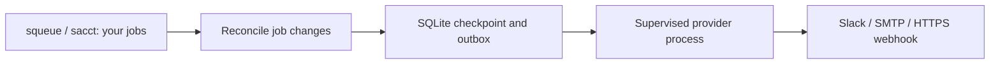

# Slurm Notify

[](https://github.com/koros/slurm-notify/actions/workflows/ci.yml)
[](https://codecov.io/gh/koros/slurm-notify)
[](https://github.com/koros/slurm-notify/actions/workflows/dependencies.yml)
[](https://scorecard.dev/viewer/?uri=github.com/koros/slurm-notify)
[](LICENSE)
[](rust-toolchain.toml)
[](docs/architecture/product-readiness.md)
[](CODE_OF_CONDUCT.md)
[](https://github.com/koros/slurm-notify/commits/main/)

Get Slack, email or HTTPS webhook alerts when your Slurm jobs finish, fail, run out
of memory or time out—without editing batch scripts, configuring `--mail-type`, or
needing root. Slurm Notify monitors your jobs as your user, saves pending alerts
locally, and retries delivery after temporary failures or restarts.

**Unreleased prototype.** Check your site's polling and execution policy before
running scheduler probes or monitoring. CI checks Linux and macOS; this is not a
supported platform or Slurm-version matrix. Rust 1.88.0 is the development
compiler, not a declared minimum supported Rust version.

## What you receive

A detailed Slack alert can look like this (synthetic values):

```text
✅ Job completed
Job: 123456 · Array task: 2
Cluster: research-cluster
Duration: 5m 0s
Exit code (status:signal): 0:0
Started: 2026-10-25T11:30:00Z
Finished: 2026-10-25T11:35:00Z
Observed: 2026-10-25T11:36:00Z
Event: evt_482417c0689d4bccb07011e02307198a
```

Detailed Slack uses a structured header, paired fields and a compact footer, with
a complete plain-text fallback. Slack details are opt-in; names require a separate opt-in and remain in protected
state/backups for the ledger's lifetime. Missing details say unavailable. Email and
generic webhooks use their own minimal payloads. See the [Slack guide](docs/operations/slack.md)
for setup, disclosure controls and upgrades from the original message format.

## Quick start

Build from source with the [pinned Rust toolchain](rust-toolchain.toml), Python 3
(for the setup recipe), and a native C compiler for bundled SQLite:

```sh
git clone https://github.com/koros/slurm-notify.git
cd slurm-notify
cargo build --release --locked
./target/release/slurm-notify --help
```

The binary runs directly; installation and administrator access are not required.
For Slack, create an incoming webhook for your intended channel, then follow the
[protected draft setup](docs/operations/slack.md). That recipe discovers the actual
Slurm cluster name, copies the complete example config, sets private state paths,
and loads the webhook URL into an environment variable through a hidden prompt.
Do not use the login hostname as an arbitrary cluster label.

With the draft ready and `SN_SLACK_DIR` set by that recipe:

```sh
./target/release/slurm-notify init --config "$SN_SLACK_DIR/config.json"
# Enter the absolute draft path, review the settings, then type yes.
./target/release/slurm-notify config validate --config "$SN_SLACK_DIR/config.json"
# After checking site policy:
./target/release/slurm-notify doctor --config "$SN_SLACK_DIR/config.json"
./target/release/slurm-notify test slack --config "$SN_SLACK_DIR/config.json"
./target/release/slurm-notify start --foreground --config "$SN_SLACK_DIR/config.json"
```

The explicit test sends one synthetic message. Keep the terminal open while
monitoring; Ctrl-C stops it. The example polls every 60 seconds and suppresses
existing history on first observation. It does not install a background service.
For email and generic HTTPS, use [getting started](docs/operations/getting-started.md)
and the [configuration examples](contracts/config/README.md).

## How it works



Checkpoints and pending alerts are saved together. Repeated observations are
deduplicated, and retries reuse the saved message. A provider may accept a message
without returning an acknowledgement, so delivery can still be duplicated.
`status` shows historical state; it does not prove a monitor process is alive.

## Status

| Feature | Status and evidence |
| --- | --- |
| Foreground monitoring, setup, validation, doctor, status | Implemented; controlled process and restart tests |
| Slack incoming webhooks | Operator-confirmed synthetic and completed-job alerts on one HPC; detailed format covered by controlled tests |
| SMTP with required STARTTLS | Controlled TLS acceptance; Gmail SMTP connections timed out on one HPC before authentication |
| Generic HTTPS webhook | Controlled acceptance, retries and restart recovery |
| HTTPS email APIs (SendGrid, Mailgun, Gmail) | [Planned](docs/architecture/https-email-delivery-roadmap.md); no adapters implemented |
| Durable outbox, routing and observation deduplication | Implemented; delivery may duplicate after an unknown acknowledgement |
| Platform and Slurm compatibility | Acceptance in progress; no support matrix established |
| Teams, log analysis, remote SSH, background service | Not implemented |
| Published releases / crates.io packages | None |

See [product readiness](docs/architecture/product-readiness.md), the
[current plan](docs/architecture/implementation-plan.md), and
[support/acceptance gates](docs/operations/support-and-acceptance.md).

## Security

Credentials are supplied through named environment variables, never inline in
config or command arguments. Config/trust/state must be protected and user-owned;
setup creates config files with mode 0600. SMTP requires explicit trusted DER
certificates and verified STARTTLS. HTTPS uses bundled public roots unless an
explicit trust bundle replaces them. TLS verification cannot be disabled.

Keep webhook URLs, job metadata and state databases out of issues and logs.
[Report vulnerabilities privately](https://github.com/koros/slurm-notify/security/advisories/new);
see [SECURITY.md](SECURITY.md) for boundaries and reporting guidance.

## Contributing

Ordinary tests use synthetic Slurm data and controlled local providers; no Slurm
cluster, email account or Slack workspace is needed. Start with
[CONTRIBUTING.md](CONTRIBUTING.md), [AGENTS.md](AGENTS.md) and the
[ADRs](docs/adr/README.md). Install the hooks and run the shared checks:

```sh
sh scripts/install-hooks.sh
sh scripts/check.sh
sh scripts/check-coverage.sh
```

The local/CI Rust line-coverage gate is 90%. The Codecov badge reports uploaded
coverage rather than the configured threshold; see [CI and coverage](docs/operations/ci-and-coverage.md)
for metric definitions and external reporting. Follow the [Code of Conduct](CODE_OF_CONDUCT.md).

Exact behavior is documented in the [CLI](contracts/cli/README.md),
[config](contracts/config/README.md) and [event](contracts/events/README.md) contracts. The
[original handoff](docs/history/SLURM_NOTIFY_DESIGN_AND_CODEX_HANDOFF.md) and
[implementation history](docs/architecture/implementation-history.md) are historical context.

## License

[MIT](LICENSE). Contributions use the same license unless explicitly agreed
otherwise. Dependencies retain their own licenses. The adapted Contributor
Covenant document retains its stated CC BY-SA 4.0 license.
