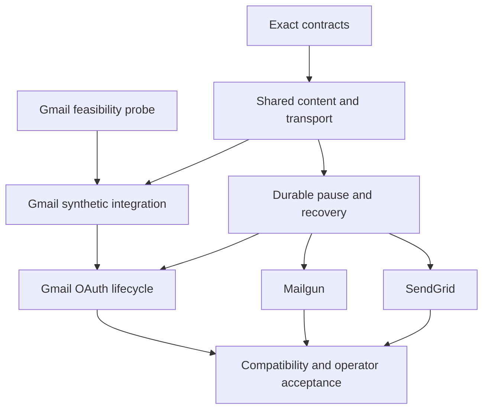

# HTTPS email delivery v1 roadmap

> **Implementation in progress.** Experimental one-shot tests are implemented;
> durable API-email monitoring and OAuth refresh remain gated. Linked issues track
> current progress.

Updated: 2026-10-27. Read the [proposal](../proposals/https-email-delivery-v1.md)
for scope and the [design notes](../proposals/https-email-delivery-v1-design-notes.md)
for transport, permissions, privacy, OAuth and recovery requirements.

## First implemented increment

[ADR 0077](../adr/0077-explicit-https-email-test-boundary.md) adopts the separate
`email test --profile` contract. Shared JSON/multipart/MIME codecs, fixed verified
HTTPS endpoints, bounded responses, typed acceptance and Gmail live identity checks
are implemented. Ordinary tests use fake credentials and controlled TLS fixtures.
See the [test guide](../operations/https-email.md).

This is partial progress on #18–#20 and #22–#24, not completion of those issues:
operator receipt, normal monitoring config, transactional freezing, permissions,
durable pause/resume and unattended OAuth still require their acceptance gates.

## Milestones

Milestones group acceptance work, not promised release dates. No due dates or
support claims are assigned. Gmail feasibility can begin independently; SendGrid
is the first integrated adapter. Mailgun and Gmail integrations depend on the
shared foundation, not on SendGrid account availability.

| Milestone | Completion evidence |
| --- | --- |
| [HTTPS email v1: contracts and foundation](https://github.com/koros/slurm-notify/milestone/2) | Reviewed exact contracts; immutable request preparation; bounded results; durable pauses and restart tests. |
| [HTTPS email v1: SendGrid](https://github.com/koros/slurm-notify/milestone/3) | Complete CLI/monitoring flow, exact acceptance semantics, controlled recovery and operator guide. |
| [HTTPS email v1: Mailgun](https://github.com/koros/slurm-notify/milestone/4) | Explicit domain/region, deterministic multipart, controlled recovery and operator guide. |
| [HTTPS email v1: Gmail API experimental](https://github.com/koros/slurm-notify/milestone/5) | One-shot probe and integration, then verified protected OAuth lifecycle before unattended monitoring. |
| [HTTPS email v1: compatibility and operator acceptance](https://github.com/koros/slurm-notify/milestone/6) | Cross-provider compatibility, backup/migration/rollback and separately recorded authorized inbox/job receipt. |

## Implementation backlog

All items start **planned**. Check the linked issue for live status and its full
acceptance checklist. A closed task is evidence for its scope only, not a release.

| Issue | Work | Depends on |
| --- | --- | --- |
| [#18](https://github.com/koros/slurm-notify/issues/18) | run a bounded Gmail API feasibility probe | Independent |
| [#19](https://github.com/koros/slurm-notify/issues/19) | adopt exact provider and persistence contracts | Independent |
| [#20](https://github.com/koros/slurm-notify/issues/20) | implement immutable content and bounded provider transport | [#19](https://github.com/koros/slurm-notify/issues/19) |
| [#21](https://github.com/koros/slurm-notify/issues/21) | add durable provider pauses and explicit recovery | [#19](https://github.com/koros/slurm-notify/issues/19), [#20](https://github.com/koros/slurm-notify/issues/20) |
| [#22](https://github.com/koros/slurm-notify/issues/22) | implement the SendGrid vertical slice | [#20](https://github.com/koros/slurm-notify/issues/20), [#21](https://github.com/koros/slurm-notify/issues/21) |
| [#23](https://github.com/koros/slurm-notify/issues/23) | implement the Mailgun vertical slice | [#20](https://github.com/koros/slurm-notify/issues/20), [#21](https://github.com/koros/slurm-notify/issues/21) |
| [#24](https://github.com/koros/slurm-notify/issues/24) | integrate experimental Gmail API synthetic delivery | [#18](https://github.com/koros/slurm-notify/issues/18), [#20](https://github.com/koros/slurm-notify/issues/20) |
| [#25](https://github.com/koros/slurm-notify/issues/25) | implement protected Gmail OAuth lifecycle | [#24](https://github.com/koros/slurm-notify/issues/24), [#21](https://github.com/koros/slurm-notify/issues/21) |
| [#26](https://github.com/koros/slurm-notify/issues/26) | verify compatibility and operator acceptance | [#22](https://github.com/koros/slurm-notify/issues/22), [#23](https://github.com/koros/slurm-notify/issues/23), [#25](https://github.com/koros/slurm-notify/issues/25) |

The acceptance issue closes only after all v1 provider gates pass. Individual
provider acceptance can be recorded earlier; failures or unavailable accounts stay
explicitly pending rather than being counted as successful tests.

## Operator prerequisites

| Workstream | Required before an external test |
| --- | --- |
| All providers | Approved site/account use, protected credentials, intended monitor node, chosen sender/recipient and an explicit send action. Check each required endpoint separately. |
| SendGrid | Account, restricted Mail Send API key and verified sender; domain authentication is recommended. US endpoint is the initial scope. |
| Mailgun | Provisioned sending domain and matching US/EU region with a Domain Sending Key, or a sandbox domain and an authorized recipient. |
| Gmail probe | Operator-owned Google project with Gmail API enabled, suitable consent/test-user setup, Desktop OAuth client and workstation browser flow. |
| Gmail unattended | Reviewed identity and refresh-token storage/ownership/rotation, approved token/identity endpoints, and a tested reauthorization path. |

Never paste credentials, OAuth codes, private URLs or raw provider responses into
issues. Record static failure stages and redacted receipt evidence only. Account
creation, payments, DNS changes, consent and real sends are operator actions.

## Required review outputs

The contract issue must settle these before implementation consumes them:

- Strict provider config and CLI grammar, credential references and sender/recipient
  validation; no executable examples until the supported contract exists.
- API-email permission enrollment and disclosure/retention previews separate from
  existing SMTP permissions and Slack metadata choices.
- Frozen body/content-type/result frames, exact success/error taxonomy, receipt
  retention, Retry-After horizons and accurate attempt counts.
- Durable pause/resume and exhausted-item requeue behavior; account changes versus
  same-account credential rotation.
- OAuth identity/scopes, credential file ownership/locking, atomic token rotation,
  helper deadlines, resource budgets and distribution limits.
- Additive state migration, closed-backup upgrade and rollback/downgrade semantics.

## Definition of done and evidence

For every implementation issue:

- Update its design/contract and user documentation with deliberate compatibility
  choices. Do not regenerate existing baselines just to make checks pass.
- Use synthetic scheduler data and controlled local TLS/API/token fixtures for
  ordinary tests; no real account or Slurm cluster is required in CI.
- Pass `sh scripts/check.sh`. Rust behavior/coverage changes also require
  `sh scripts/check-coverage.sh` at the existing 90% minimum; verify hosted checks.
- Cover normal, rejected, unknown-acceptance and restart behavior, privacy and
  provider isolation. A provider POST succeeding is not a complete vertical slice.

The final acceptance record must separate provider submission from observed inbox
receipt, identify the exact node/account/provider/region without publishing secrets,
and state which job scenarios were verified. One CPU is sufficient for permitted
completed/failed/cancelled dummy jobs. Do not induce shared-node failures or infer
broad platform support. Releases require separate explicit authorization.

## Next increment

Start with [#19](https://github.com/koros/slurm-notify/issues/19) for the exact contract package. In parallel with
that review, an operator can prepare [#18](https://github.com/koros/slurm-notify/issues/18) to answer the immediate Gmail
HTTPS connectivity/receipt question. This roadmap authorizes no automatic live send.
