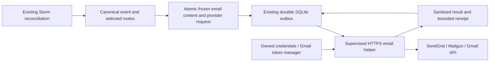

# HTTPS email delivery v1: design notes

> **Proposed design, not an implemented interface.** Exact config, CLI, permissions,
> resource budgets and persistence contracts require review before implementation.

Updated: 2026-10-27. These notes preserve the security, transport and recovery
requirements behind the [proposal](https-email-delivery-v1.md). Start with the
[roadmap](../architecture/https-email-delivery-roadmap.md) for milestone and issue
status. Existing SMTP, webhook and Slack contracts remain unchanged.

## Contents

- [Provider wire contracts](#provider-wire-contracts)
- [Architecture](#architecture-and-integration-points)
- [Content and durable state](#content-permissions-and-durable-state)
- [TLS, credentials and privacy](#tls-credentials-resources-and-privacy)
- [Errors and recovery](#error-policy-attempts-and-recovery)
- [Gmail OAuth](#gmail-oauth-and-early-testing)
- [Validation matrix](#validation-matrix)
- [Provider references](#provider-references)

## Provider wire contracts

| Provider | Fixed API target | Authentication and prerequisite | Provider acceptance |
| --- | --- | --- | --- |
| SendGrid v3 | `POST https://api.sendgrid.com/v3/mail/send` | Restricted Mail Send API key; verified sender identity, authenticated sending domain recommended | HTTP 202; optional bounded provider request/message identifier |
| Mailgun | `POST https://api.mailgun.net/v3/{domain}/messages` or `https://api.eu.mailgun.net/v3/{domain}/messages` | Domain Sending Key using HTTP Basic username `api`; verified sending domain, or sandbox with authorized recipient | HTTP 200 plus a valid bounded JSON message ID |
| Gmail API | `POST https://gmail.googleapis.com/gmail/v1/users/me/messages/send` | OAuth bearer access token with `gmail.send`; enabled API and permitted/test user | HTTP 200 plus a valid bounded Message ID |

SendGrid's initial endpoint is explicitly the US API. An EU SendGrid endpoint is
not inferred or silently selected; a regional variant requires its own verified
account/API contract. Mailgun region is explicit and must match domain provisioning;
never switch regions automatically after failure. Arbitrary endpoint overrides,
custom authorization headers and account/recipient redirects are not exposed.

SendGrid: JSON with fixed `personalizations`, `from`, `subject`, plain-text content
and explicit tracking disabled. No sandbox success is counted as a real email send.

Mailgun: deterministic multipart request for `from`, `to`, `subject`, `text` and
tracking-off options. Do not enable Mailgun test mode for a receipt test; a
sandbox domain with an authorized recipient is different and can deliver email.
Validate the domain as a DNS name, never interpolate an
unchecked path/query component. Freeze the multipart boundary and request bytes.

Gmail: construct deterministic RFC-compliant MIME with the existing reviewed email
builder, then base64url-encode it into JSON `raw`. Do not confuse base64url with
SMTP AUTH Base64. Initially permit only the authenticated account as sender, not
arbitrary send-as aliases. Never request mailbox-read permissions to confirm receipt.

All responses describe provider submission/queue acceptance. They do not prove
recipient delivery, absence from spam, or human viewing. Gmail also documents
mail-limit cases where a successful HTTP response is insufficient to infer delivery.
A stable event ID and RFC Message-ID aid correlation, not exactly-once delivery.

## Architecture and integration points

Keep Rust internals private. Likely touch points are `config_validate`,
`config_composition`, `init` review, `webhook` HTTP policy, `transport` supervision,
`supervised_provider` result mapping, delivery dispatch and transactional storage.
The current composition treats non-SMTP providers as webhook-like; replace that
assumption with exhaustive private dispatch before adding email provider types.

Do not push email through the generic webhook event schema or interpret an existing
webhook alias as email. Its current JSON and HTTP acknowledgement policy are not
an email API contract. A separate bounded request/result protocol is warranted:
Mailgun/Gmail need response parsing, Gmail has token refresh, and provider-specific
success/error semantics differ from the generic 2xx policy. Existing helper grammar
must remain valid and unchanged for existing providers.

Reuse existing `ureq`, rustls, serde_json, zeroize, Base64, hashing and email builder
where they meet the requirements. Evaluate form/multipart and OAuth support before
adding dependencies. Any new library needs Rust 1.88 compilation, source/license/
advisory review, bounded I/O and no automatic retry/redirect/proxy behavior.

## Content, permissions and durable state

1. Define a transport-neutral, immutable `EmailContentV1` derived from the existing
   canonical public event. Propose explicit fields: state, job/array identifier,
   cluster, observation time and public event ID. Review their disclosure; do not
   silently expand existing SMTP permissions or borrow opt-in Slack names.
2. Render deterministic subject/text and stable Date/Message-ID metadata. Sender,
   recipient, disclosure, renderer version, provider kind, region/domain and stable
   authenticated account identity all participate in the destination binding.
3. Prepare content and exact provider request body in the same transaction as the
   event UUID, selected routes, checkpoint and outbox. Include content type and body
   integrity checks. A preparation failure rolls back the complete poll transaction.
4. Retry the frozen request after restart. Do not rerender using changed accounting,
   recipients, templates or timestamps. HTTP Authorization and OAuth tokens are
   transient, supplied at dispatch; never persist them in frozen requests or SQLite.
5. Add API-email-specific explicit permission enrollment. Existing SMTP permission
   pairs authorize SMTP only. `init` previews sender/recipient, provider/region,
   account identity, disclosed fields, retention and duplicate-delivery limitations.
   Credential values, OAuth URLs/codes and raw server errors are not previewed.
6. Credential rotation for the same approved account must not rerender or invalidate
   pending work solely because a secret changed. Account/domain/region/recipient/
   disclosure changes block old pending work until deliberately resolved. Stable
   credential references and account identity, not stored secret hashes, bind work.
   Do not claim an API key's owning account is locally verifiable without a provider
   identity endpoint; verified domain/sender plus explicit operator enrollment are
   the initial boundary for API-key providers.
7. Use an additive, transactionally tested schema migration for email request/receipt
   records and provider pause state if needed. Confirm the current schema ceiling
   before assigning a version. Old v4/v5/v6 state stays readable; migration occurs
   only when a new adapter needs its records. Old binaries reject the new schema.
   Document stopped-owner backup, upgrade, downgrade and possible replay; never
   delete state or alter user_version as an upgrade shortcut.
8. Freeze no credentials and retain no arbitrary response bodies. Any optional
   provider ID is bounded, protected, excluded from ordinary logs/status and covered
   by a stated retention policy. Email addresses/content in immutable records may
   outlive outbox cleanup; disclose that before enrollment.

Proposed configuration types are `sendgrid`, `mailgun` and `gmail_api`. Exact keys,
secret-reference names, permission shape and any new auth/resume CLI grammar are
review outputs, not supported interfaces yet. Reject unknown fields/types and
cross-provider credentials. Keep schema_version 1 only if an additive contract
review confirms that is intentional; do not silently rewrite existing configs.

## TLS, credentials, resources and privacy

- Only HTTPS on the provider's fixed port 443; verified hostname/certificates,
  current bundled-root or explicit protected DER trust policy, no redirects,
  implicit proxy discovery, TLS-disable option or automatic port/provider fallback.
  HTTPS protects the cluster-to-provider hop; recipient mail transport is managed
  by the provider, not an end-to-end encryption guarantee.
- API keys use explicit environment references, separate from SMTP username/password.
  Restrict SendGrid keys to Mail Send and Mailgun keys to the selected sending
  domain. Never use an account-administration key when a sending key suffices.
- Google OAuth credentials use an explicit protected file reference. Reuse the
  descriptor-owned, mode-0600/no-symlink reader and mode-0700 directory policy.
  State/backups and credential files remain separate; no committed token files,
  argv secrets, shell-history examples, raw diagnostics or payload dumps.
- Clear child environments and pass only the owned bounded secret snapshot needed
  for that dispatch. Zeroize secret buffers; do not log their Debug representation.
- Set explicit connect/read/write/total helper deadlines, header/body/request budgets,
  response-depth limits and token-response limits. Include multipart/base64 expansion
  in request limits, not just the source text. Start with conservative reviewed
  bounds compatible with the existing 16 KiB request class, not vendor megabyte limits.
  A candidate is 8 KiB parsed error/receipt bodies and 16 KiB token responses; confirm
  exact budgets and overall refresh-plus-send deadline before contract adoption.
- Disable provider click/open tracking and analytics in request options where
  supported. Do not bypass suppression lists. Review account-side tracking/footer
  policies and provider data handling; do not promise providers retain no metadata.
- No scripted account signup, payments, DNS edits or consent grants in ordinary
  tests. Account setup and externally visible tests remain operator actions.

## Error policy, attempts and recovery

Use typed internal outcomes with an explicit acceptance state: not attempted,
not accepted, accepted, or unknown. Map them deliberately into persistence; the
existing internal `Delivered` label must not become a claim of inbox delivery.
Never treat all 2xx as success for these adapters.

| Observation | Proposed behavior |
| --- | --- |
| Missing/unsafe credentials, denied permission, mismatched endpoint/account before request | Block without fabricating a send attempt; existing config/start validation still fails invalid static inputs |
| Valid provider-specific success | Atomically record bounded acknowledgement/receipt and complete that destination only |
| Connect/DNS failure, 408/429 or retryable 5xx | Existing bounded exponential backoff/jitter/max attempts; honor valid Retry-After within reviewed policy |
| Timeout/disconnect after submission, malformed/truncated success response, crash before local completion commit | Record unknown acceptance and use documented at-least-once retry policy; a duplicate may result |
| Invalid payload/recipient or other definitive non-retryable rejection | Record sanitized permanent failure; no unbounded resends |
| Invalid/revoked API key, missing OAuth scope, disabled API or account/domain policy denial | Pause the affected new provider with a static actionable reason; preserve pending work and keep other valid routes progressing |
| Gmail 403 rateLimitExceeded/userRateLimitExceeded or documented quota response | Parse only bounded allowlisted reason codes; quota/backoff policy, not a blanket permanent-403 rule |

Provider pauses must survive restart, avoid hot loops and retain accurate attempted
submission accounting. Preflight failure and an HTTP 401 after a network request
are not the same event. Review/add the storage representation and an explicit local
resume operation in the contract phase; do not hide attempted requests by mapping
them to the current preflight-not-attempted result. Missing error reasons fall back
to safe generic classification; raw error text never becomes a diagnostic.

Gmail: refresh expiring tokens before a request. On an unambiguous 401, invalidate
the cached access token and allow one refresh before the next scheduled attempt;
count each actual send request, retain the same frozen message, and pause after a
fresh token is also rejected. OAuth exchanges do not consume email-send attempts,
but have their own bounded deadline/backoff. Resuming a provider does not reset
email attempt counts; an exhausted delivery needs a separately reviewed explicit
retry/requeue action, never an implicit reset. No hidden SDK retries or endless
refresh/send cycles. Explicit synthetic `test` sends once and never auto-resends.

Do not assume SendGrid, Mailgun or Gmail deduplicate a repeated POST/Message-ID.
No exactly-once claim without a documented API-specific guarantee and acceptance.
A valid long Retry-After must not be shortened to the local exponential-backoff
maximum; persist its due time, or pause for operator action if it exceeds the
reviewed timestamp/horizon budget. Honor max_attempts on every actual send.
No automatic fallback to a second provider after unknown acceptance. Delivery-event
webhooks, mailbox searches and provider-ID reconciliation are separate future work;
they need additional exposure/scopes and do not remove all ambiguity windows.

## Gmail OAuth and early testing

### One-shot feasibility test

1. On a workstation with a browser, create/use an operator-owned Google Cloud test
   project, enable Gmail API, configure consent/test users and create a Desktop
   OAuth client. No embedded shared project/client secret is shipped by the repo.
2. Use Google's supported authorization-code flow with PKCE, state and loopback
   callback on the workstation. Do not start a callback listener on the HPC, use
   deprecated out-of-band code pasting or assume a generic device flow supports
   the requested Gmail scopes. Use an official client library for the short-lived
   development probe if helpful; it is not a Rust runtime dependency.
3. Request `gmail.send` for mail sending. For authenticated-account binding, add
   only OpenID `openid` and `email`, verify identity through the supported OIDC
   flow/userinfo endpoint, and bind subject plus verified account address. If using
   ID tokens, validate signature, issuer, audience, expiry and nonce with a reviewed
   library; do not trust a decoded JWT payload alone. Do not
   add gmail.readonly/modify or call users.getProfile under send-only credentials.
4. Transfer the short-lived token securely into a protected resource on the HPC;
   do not paste tokens into chat, argv or screenshots. No SMTP app-password reuse.
5. From the intended monitor node, first verify DNS/TLS to `gmail.googleapis.com`.
   Then explicitly send one synthetic message to the operator's selected inbox via
   the exact messages.send endpoint. Record sanitized status/stage and ask the
   operator to confirm actual inbox/spam receipt. No scheduler or outbox activity.
6. Revoke/discard the probe credential after the experiment. A successful probe
   proves only that tested account/node/transport, not unattended OAuth recovery.

### Durable experimental Gmail provider

- Request offline access during workstation consent. Preserve the refresh token
  when subsequent grants omit a replacement. Access tokens are short-lived; use
  returned expiry, a safety margin and bounded in-memory caching, not a hardcoded
  assumption that tokens or refresh grants never expire.
- Verify credential/client/account bindings using Gmail send plus the minimal OIDC
  identity scopes. An authenticated identity change blocks pending work. No sender
  aliases or mailbox reads in the first release of the adapter.
- The cluster needs approved direct HTTPS access to Gmail, OAuth token and identity
  endpoints: `gmail.googleapis.com`, `oauth2.googleapis.com`, and
  `openidconnect.googleapis.com`. Browser consent additionally uses Google's
  workstation authorization endpoints. Verify each required host separately.
- Use a supervised bounded token exchange with single-flight refresh. Concurrent
  destinations share an account manager. If multiple monitor processes can use the
  same credential file, use credential-level exclusive ownership/locking or reject
  concurrent use; state-file ownership alone is insufficient.
- Keep refresh tokens and any client secret only in protected credential storage.
  If a grant rotates a refresh token, atomically persist the replacement using the
  existing protected-publication principles before depending on it. Sync/write
  failure blocks further use; never overwrite unrelated credentials or lose the old
  file on partial publication. This is an explicit credential-store update contract,
  not an excuse to weaken config's no-overwrite publication policy.
- `invalid_grant`, revoked consent, mismatched identity, reduced scope or account
  policy requires explicit operator reauthorization; monitoring never opens a browser.
  Other enabled providers continue. Auth login/status/logout/resume operations need
  resource-free help, privacy-safe output and dedicated acceptance before exposure.
- External OAuth projects in Google's Testing status normally issue refresh tokens
  expiring after seven days for these scopes. Public distribution with gmail.send,
  a sensitive scope, needs the applicable Google verification/policy review. Treat
  this adapter as experimental/testing until credential lifecycle and distribution
  are reviewed; do not advertise a permanent free email relay or unlimited sending.

## Validation matrix

Ordinary tests use synthetic scheduler data, fake keys/tokens and controlled local
TLS/API/token servers. They require no Slurm cluster, commercial provider account,
Google account, live email, incoming public endpoint or real credentials.

- Wire: fixed endpoints, region/domain escaping, deterministic message/request IDs,
  CRLF/header-injection rejection, Unicode/invalid-address policy, multipart boundary
  collisions, base64url correctness and post-encoding byte limits.
- Privacy: no raw HTTP/OAuth body/URL query/token/recipient in diagnostics; no tokens
  in SQLite, frozen frames or fixtures; tracking options; opt-in fields stay local
  to their approved destination; all secret owners/drop paths exercised.
- TLS/network: trusted success, wrong hostname, untrusted/expired certificate,
  redirect refusal, proxy environment ignored, stalled DNS/connect/headers/body,
  bounded non-JSON/oversized/gzip/error responses and cancellation at every stage.
- Outcomes: exact success codes, 400/401/403/404/408/429/5xx, Gmail quota-versus-policy
  reasons, valid/malformed Retry-After, paused provider isolation and retry budgets.
- Durability: poll rollback, persisted immutable bytes, killed-owner recovery,
  provider-accepted/local-commit-failed replay, partial mixed-route success, pause
  recovery, sender/recipient/region/account/disclosure edits and old-schema rejection.
- OAuth: expiry during a long session, missing/revoked/rotated refresh token, no
  replacement token, client/account mismatch, narrowed scopes, concurrent owners,
  token-file permissions/symlinks, bounded helper IPC and atomic persistence faults.
- CLI: resource-free help, validation/doctor without provider calls or refresh,
  init review/enrollment without sending, synthetic test with one submission only,
  historical acceptance wording and no false live-health/inbox-delivery claim.
- Tooling: install hooks, shared checks, strict rustdoc, Actionlint for workflow
  changes, dependency policy for any new crate, unchanged approved baselines, and
  the existing 90% Rust line gate for Rust/coverage changes. Check hosted Linux/macOS
  separately; do not exclude source/profiles or lower the gate to pass new adapters.

External acceptance uses an operator-controlled sender/recipient and a permitted
single-CPU synthetic Slurm job for complete/fail/cancel scenarios. No GPU is needed.
Check the exact node used for monitoring; login-node success does not establish a
compute-node path. Capture redacted screenshots only after confirmed receipt.

## Provider references

- [SendGrid v3 Mail Send and response/settings contract](https://www.twilio.com/docs/sendgrid/api-reference/mail-send/mail-send)
- [SendGrid API host/authentication setup](https://www.twilio.com/docs/sendgrid/for-developers/sending-email/api-getting-started)
- [SendGrid restricted Mail Send key and sender setup](https://static0.twilio.com/docs/sendgrid/for-developers/sending-email/quickstart-nodejs)
- [Mailgun send API](https://documentation.mailgun.com/docs/mailgun/api-reference/send/mailgun/messages/post-v3--domain-name--messages)
- [Mailgun authentication/domain sending keys](https://documentation.mailgun.com/docs/mailgun/api-reference/mg-auth)
- [Mailgun regional endpoints](https://documentation.mailgun.com/docs/mailgun/api-reference/api-overview)
- [Mailgun sandbox authorized recipients](https://documentation.mailgun.com/docs/mailgun/quickstart)
- [Gmail MIME/base64url sending](https://developers.google.com/workspace/gmail/api/guides/sending)
- [Gmail messages.send endpoint](https://developers.google.com/workspace/gmail/api/reference/rest/v1/users.messages/send)
- [Gmail scope classification](https://developers.google.com/workspace/gmail/api/auth/scopes)
- [Gmail errors and mail quota caveats](https://developers.google.com/workspace/gmail/api/guides/handle-errors)
- [Google desktop OAuth flow](https://developers.google.com/identity/protocols/oauth2/native-app)
- [Google OIDC identity/userinfo contract](https://developers.google.com/identity/openid-connect/reference)
- [Google refresh-token expiration/testing limits](https://developers.google.com/identity/protocols/oauth2#expiration)
