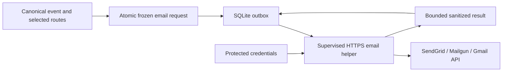

# HTTPS email delivery plan v1

> **Status: proposed.** This plan adds no working provider, CLI command, config
> field or database contract. Implementation starts with an exact contract review.

Updated: 2026-10-27 · [Roadmap and GitHub tracking](../architecture/https-email-delivery-roadmap.md)
· [Technical design notes](https-email-delivery-v1-design-notes.md)

## Goal

Send Slurm job alerts through email providers over verified HTTPS on port 443,
using SendGrid, Mailgun or an experimental Gmail API adapter. Preserve durable
retries, explicit disclosure choices and the existing SMTP, Slack and generic
webhook behavior.

One HPC environment demonstrated Slack HTTPS delivery while Gmail SMTP connections
failed before authentication. This motivates another transport; it does not prove
that most HPC sites block SMTP or identify who caused those connection failures.
All provider use remains subject to site and account policy. SMTP stays available.

## Scope

| Included in v1 planning | Deferred |
| --- | --- |
| One sender and one recipient per destination | CC/BCC, bulk sending and mailing lists |
| Plain-text messages with reviewed minimal job fields | HTML, attachments and provider templates |
| SendGrid and Mailgun sending APIs | Arbitrary compatible APIs, SES and local sendmail |
| Experimental Gmail sending and protected OAuth lifecycle | Mailbox reads, send-as aliases and domain-wide delegation |
| Explicit provider routes and durable retries | Automatic cross-provider failover |
| Local foreground monitoring as the current user | Administrator-operated multi-user monitoring and user registration |
| Provider acceptance plus operator-confirmed receipt tests | Public inbound bounce/delivery webhook service |

Job names and other Slack opt-in metadata are not automatically included in email.
HTTPS protects the connection to the provider; it is not end-to-end email encryption.
An API acceptance response does not prove inbox delivery or human receipt.

## Provider approach

| Provider | Authentication | Message encoding | Initial role |
| --- | --- | --- | --- |
| SendGrid | Restricted Mail Send API key; verified sender | JSON | First integrated adapter |
| Mailgun | Domain Sending Key; explicit US/EU sending domain | Deterministic multipart | Second integrated adapter |
| Gmail API | OAuth; sending plus minimal verified identity scopes | MIME encoded as base64url in JSON | Early one-shot probe, then experimental integration |

Gmail API does not use an SMTP app password. SendGrid and Mailgun send through
their own services; either can deliver to a Gmail recipient without Gmail API.
No account creation, paid subscription, DNS change or external send is automated
by this planning work. Operator prerequisites are recorded in the roadmap.

Exact endpoints, success codes, permissions and provider-specific errors are in
[the design notes](https-email-delivery-v1-design-notes.md#provider-wire-contracts).
Recheck provider documentation when adopting each contract.

## Delivery sequence

1. **Gmail feasibility probe:** one explicitly invoked synthetic send from the
   intended HPC node, after workstation OAuth consent and secure credential setup.
   No Slurm queries, outbox writes or automatic resend. Record observed receipt or
   a classified blocker. This can run independently of domain/API-key setup.
2. **Contracts and foundation:** adopt exact config/CLI/disclosure/permission,
   bounded request/result, pause/resume, OAuth ownership and migration semantics.
   Implement immutable content and the supervised HTTPS email path.
3. **SendGrid:** complete the first setup-to-monitoring vertical slice, with
   controlled failure/restart tests and an operator guide.
4. **Mailgun:** add explicit region/domain binding and frozen multipart requests,
   reusing the shared foundation without automatic endpoint failover.
5. **Experimental Gmail:** integrate one-shot sending first. Enable unattended
   monitoring only after protected refresh, identity, rotation, revocation,
   concurrency and restart acceptance.
6. **Compatibility and operator acceptance:** verify mixed routes, closed-backup
   upgrade/rollback, intended inbox receipt and CPU-only job alerts for each adapter.

The [roadmap](../architecture/https-email-delivery-roadmap.md) maps these steps to
GitHub milestones, implementation issues, dependencies and completion criteria.
No dates or release commitments are assigned before contract review and account
prerequisites are resolved.

## Architecture

Reuse the existing HTTP/TLS, supervision, email-building and persistence boundaries
where suitable. Do not reinterpret a generic webhook as email or change existing
helper grammars. Keep Rust internals private; new dependencies need a concrete
reason and source/license/advisory review.

## Non-negotiable implementation requirements

- Verified TLS, fixed provider endpoints, explicit region/domain binding and bounded
  I/O. No redirects, ambient proxy discovery or hidden SDK retries.
- Credentials from protected resources; never config literals, command arguments,
  frozen requests, logs, fixtures or screenshots.
- Freeze exact credential-free request bytes with the event/checkpoint/outbox
  transaction. Retries and restarts reuse those bytes without changing recipients,
  message content or disclosure.
- Bind account, sender, recipient, region and renderer choices. Changed identity or
  disclosure blocks pending work; credential rotation for the same approved account
  does not silently rewrite it.
- Record acceptance uncertainty honestly. Lost acknowledgements can cause duplicate
  sends; do not promise exactly-once delivery or switch providers automatically.
- Persist provider-specific authentication/policy pauses, preserve actual attempt
  counts and keep unrelated routes progressing. Resume does not reset exhausted work.
- Test schema migration, transaction rollback and stopped-owner backup/downgrade.
  Never delete state or lower its version to make an upgrade work.

The [design notes](https-email-delivery-v1-design-notes.md) expand these requirements,
including OAuth scopes, token expiry, atomic rotation, Retry-After and byte budgets.

## Definition of done

A provider is complete only when its reviewed contracts, local CLI flow, durable
submission/recovery behavior, controlled tests and operator documentation are
implemented. An HTTP POST working on its own is insufficient.

Ordinary tests use fake credentials, synthetic scheduler data and controlled TLS/API
fixtures. Run `sh scripts/check.sh`; Rust behavior changes must also pass
`sh scripts/check-coverage.sh` with at least 90% Rust line coverage. Verify hosted
checks separately. No live provider account or Slurm cluster is needed for CI.

Operator acceptance requires site/account authorization, the exact monitor-node
network path, observed inbox/spam receipt, and permitted one-CPU job scenarios.
Record each provider/account/region separately. Untested cases remain pending;
there is no supported-platform or automatic release claim.

## Decisions still required

- Exact provider config, permission enrollment and account-identity contracts.
- Pause/resume, exhausted-item requeue and historical status/help wording.
- OAuth file format, locking/rotation/identity scopes and distribution policy.
- Request/response/token budgets, helper deadlines and migration version.
- Available provider accounts, verified senders/domains and operator test timing.

Creating GitHub milestones records planned work; it does not adopt these public
interfaces. The next engineering increment is the contract-review issue, while an
operator can independently prepare the Gmail feasibility probe.

## References

- [SendGrid Mail Send API](https://www.twilio.com/docs/sendgrid/api-reference/mail-send/mail-send)
- [Mailgun regional API overview](https://documentation.mailgun.com/docs/mailgun/api-reference/api-overview)
- [Gmail MIME/base64url sending](https://developers.google.com/workspace/gmail/api/guides/sending)
- [OAuth, errors and additional provider references](https-email-delivery-v1-design-notes.md#provider-references)
